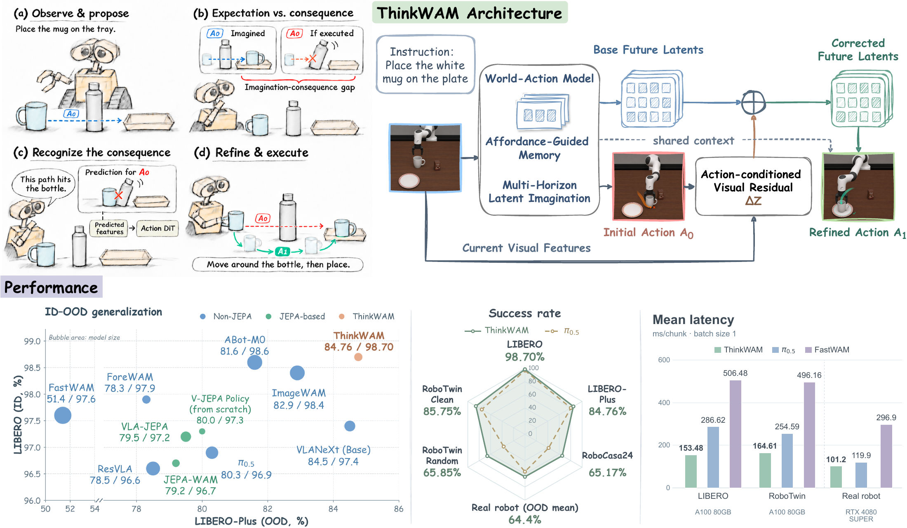

<div align="center">

# ThinkWAM: Rethinking Latent Futures for Action Refinement

**Predict in latent space. Refine before execution.**

[](#getting-started)
[](https://arxiv.org/abs/2611.21258)
[](https://thinkwam-project.github.io/)
[](https://huggingface.co/Adrain11/ThinkWAM)

[Overview](#overview) · [Setup](#getting-started) · [Training](#training) · [Evaluation](#evaluation) · [Documentation](#documentation)

</div>

ThinkWAM is a latent world-action model for robot manipulation. It proposes an action chunk, uses the proposal to refine predicted future latents, and generates the executable chunk through the **same ActionDiT**. This repository provides the model, training recipes, and evaluation tools for LIBERO, LIBERO-Plus, RoboTwin 2.0, and RoboCasa24.

## Overview

<p align="center">
  <a href="docs/assets/overview.png"></a>
</p>

## Getting started

Use **Linux, Python 3.10+, and a compatible PyTorch/CUDA environment**. Install PyTorch for your CUDA setup before the remaining dependencies.

```bash
git clone https://github.com/HaoyunT/Thinkwam.git
cd Thinkwam
python -m pip install -r requirements.txt
python -m pip install -e .
```

Prepare the datasets and local V-JEPA/Qwen assets, then set their paths in [configs/paper/](configs/paper/). See the [setup and data guide](docs/TRAINING.md) for FlashAttention, benchmark dependencies, and input validation.

## Training

The appendix recipes use **four A100 80GB GPUs**. LIBERO and RoboCasa24 train in two stages, **P0 → P1**; RoboTwin uses one joint stage. Run from the repository root after preparing the configured inputs:

```bash
export PYTHON=python
export CUDA_VISIBLE_DEVICES=0,1,2,3

# LIBERO
bash scripts/train_paper.sh libero-p0
bash scripts/train_paper.sh libero-p1

# RoboTwin
bash scripts/train_paper.sh robotwin

# RoboCasa24
bash scripts/train_paper.sh robocasa24-p0
bash scripts/train_paper.sh robocasa24-p1
```

Each P1 stage starts from its final P0 checkpoint. Hyperparameters are in the [five recipe files](configs/paper/); initialization and resume options are described in the [training guide](docs/TRAINING.md#stage-initialization-and-recovery).

## Evaluation

Download the [published checkpoints](https://huggingface.co/Adrain11/ThinkWAM) and follow the [evaluation guide](docs/RELEASED_CHECKPOINTS.md). Use **`--checkpoint-profile released`** with these weights.

Evaluation requires the corresponding simulator, assets, and normalization statistics. The guide includes commands for LIBERO/LIBERO-Plus, RoboTwin Clean/Random, and RoboCasa24, plus checkpoint verification and regression checks.

## Documentation

- [Training and data preparation](docs/TRAINING.md)
- [Checkpoint loading and evaluation](docs/RELEASED_CHECKPOINTS.md)
- [Optional cache formats](docs/P0_DATA_CACHE.md)
- [Model and protocol tests](tests/)

## License

Original ThinkWAM code is released under the [MIT License](LICENSE). Third-party
components retain their own terms: in particular, the SIGReg component follows
LeJEPA's **CC BY-NC 4.0** license. See [Third-party notices](THIRD_PARTY_NOTICES.md)
for exact scope, upstream model licenses, and attribution.
